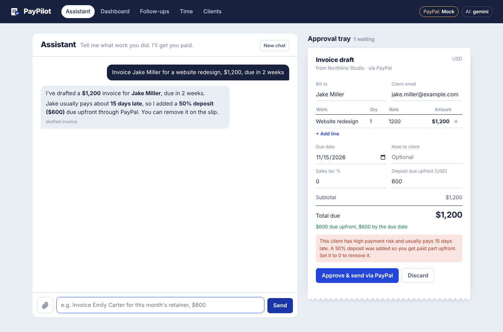
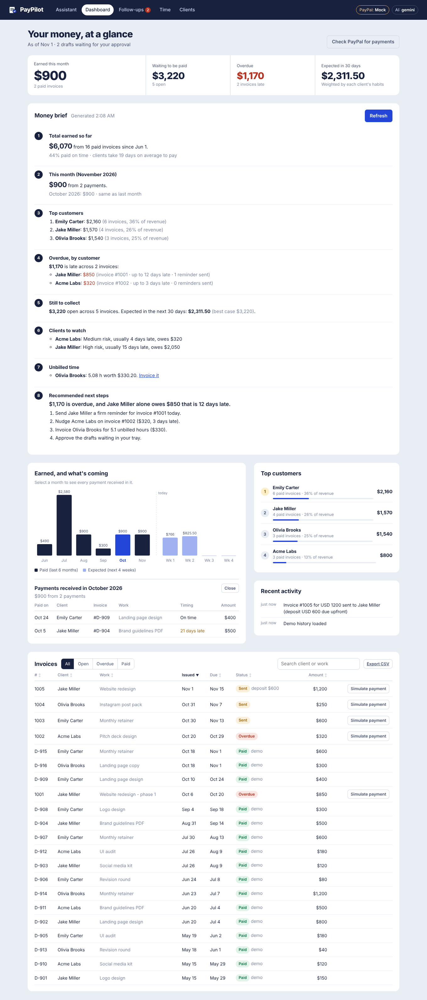
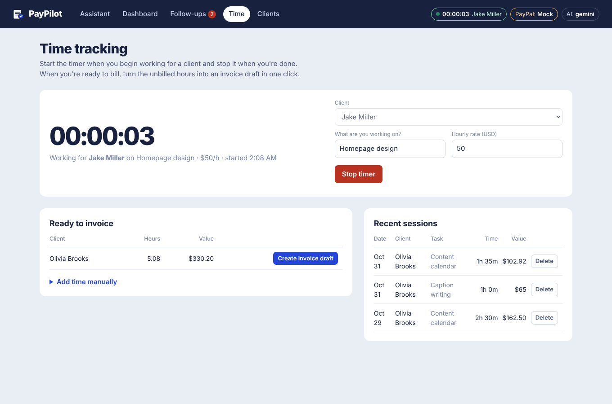
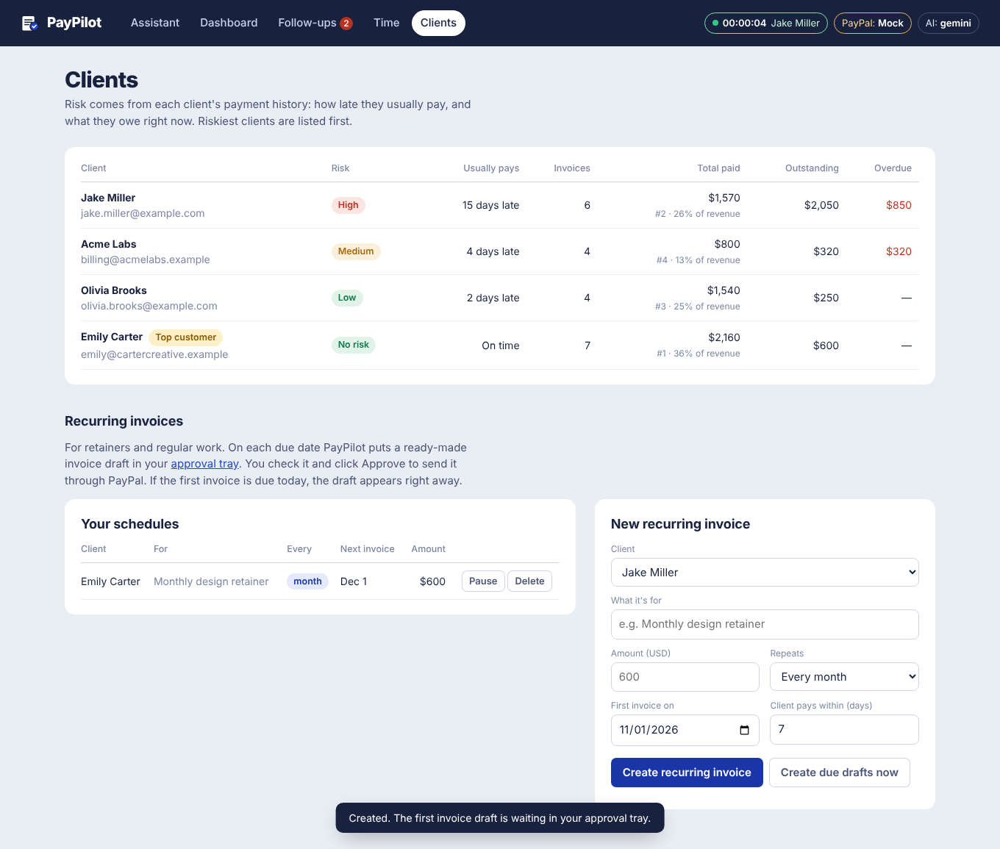
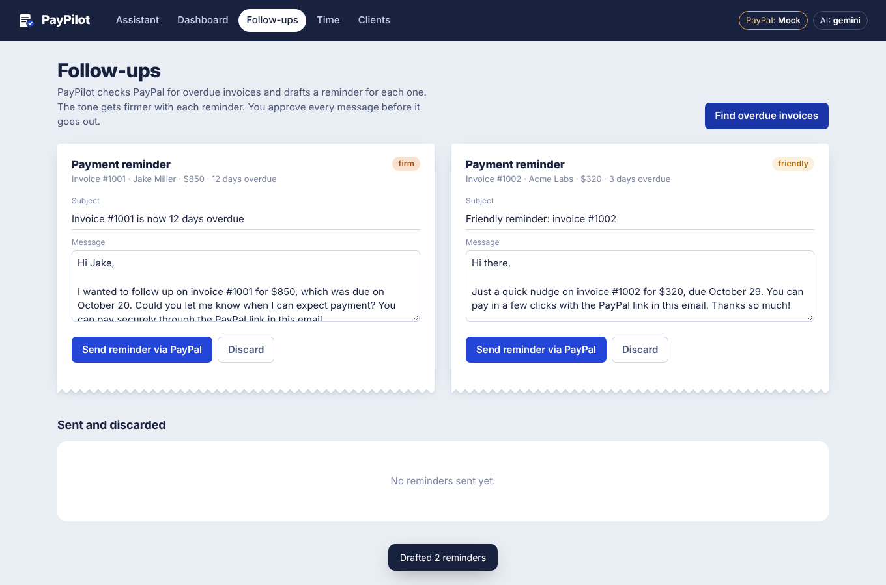
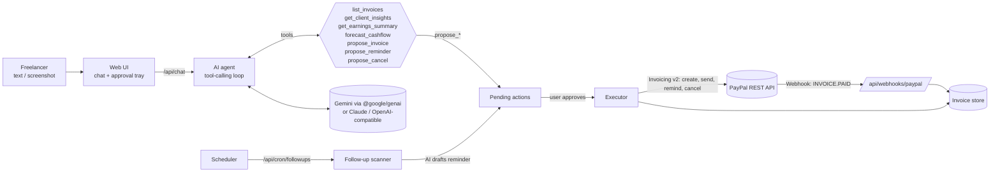

# PayPilot: an AI payments agent for freelancers, built on PayPal

**Tell PayPilot what work you did, in plain words or as a screenshot. It drafts a PayPal invoice, sends it once you approve, chases late payers with reminders whose tone escalates, and tells you what cash is coming.**

Built for the *Build What's Next with PayPal and AI* hackathon.



---

## The problem

Freelancers lose time and money on getting paid:

- Invoicing gets put off because it's tedious.
- Chasing late clients is awkward, so people don't do it.
- Payment status is scattered across email, WhatsApp and spreadsheets.
- There's no clear view of what cash is coming next month.

## What PayPilot does

| Feature | How it works |
|---|---|
| **Text → invoice** | *"Bill Jake (jake@abc.com) for 3 logo concepts at $150 and an urgent revision for $60, due in 10 days."* The AI extracts the client, line items, rates and due date, and puts an editable **invoice slip** in the approval tray. |
| **Screenshot → invoice** | Attach or paste a screenshot of a client email or chat. A vision model reads it and drafts the invoice. |
| **Human-in-the-loop** | The AI can only *propose*. Nothing reaches PayPal or the client until you click **Approve & send via PayPal**. You can edit any field first. |
| **Real PayPal invoices** | Approved drafts are created and sent with the **PayPal Invoicing v2 API**. The client gets PayPal's email and payment page. |
| **Live payment status** | **PayPal webhooks** (`INVOICING.INVOICE.PAID`, with signature verification) and on-demand polling update the dashboard as soon as a client pays. |
| **Client risk** | Each client is rated **No risk / Low / Medium / High** from their payment history (average days late, share of late payments, current overdue). The agent warns you before you invoice a risky client. |
| **Escalating follow-ups** | PayPilot scans for overdue invoices, and the AI drafts a reminder for each whose tone moves from *friendly* to *firm* to *final*, based on reminders already sent and days overdue. Approve, and it goes out through PayPal's **remind** endpoint. This can run on a schedule. |
| **Deposits for risky clients** | When a client usually pays late, the agent automatically adds a **50% upfront deposit** using PayPal's **partial-payment** option, and tells you why. You can change or remove it on the slip. |
| **Sales tax** | Add a sales-tax % to any invoice ("plus 8% sales tax"). It's sent to PayPal as per-line tax, so the client sees a proper breakdown. |
| **Recurring invoices** | Set up from a simple form on the Clients page or by asking *"Bill Emily $600 every month"*. On each due date a ready-made draft lands in your approval tray (the first one immediately if it starts today), so nothing auto-sends. Pause, resume or delete any time. |
| **Money brief** | One click gives a step-by-step report: total earned so far, this month vs last month, top customers, overdue amount by customer, what's still to collect, clients to watch, and unbilled time. It ends with AI-written recommendations. The numbers are computed in code; the AI only writes the headline and actions. |
| **Live time tracking** | Start and stop a timer per client and task; a live clock shows in the top bar on every page. Unbilled hours become an invoice draft in one click (or ask the agent: *"Invoice my tracked hours for Olivia"*). Billed hours are locked so they can't be invoiced twice. |
| **Interactive dashboard** | Click a summary card to filter invoices, click a month in the chart to see every payment received that month, sort any column, search, and export everything to CSV for your accountant. |
| **Top customers** | Clients ranked by money actually received, with their share of revenue, on the dashboard and Clients page. Ask the agent *"Who is my best customer?"* |
| **Cash-flow forecast** | Expected incoming money over the next 30 days, weighted by each client's real payment behaviour. |
| **Ask anything** | *"Who owes me money?"*, *"How much did I earn this month?"*, *"Cancel Olivia's invoice."* The agent answers from your real PayPal data, never from guesses. |

| Dashboard + money brief | Time tracking | Clients and recurring invoices |
|---|---|---|
|  |  |  |

| Follow-ups |
|---|
|  |

---

## Architecture



**Stack.** Node.js + **Express 5** API, **SQLite** (Node's built-in `node:sqlite`, with a transactional repository layer and automatic migrations), **Google Gen AI SDK** (`@google/genai`) for Gemini, PayPal REST APIs, and a vanilla-JS frontend.

**Reliability and security.**
- **Exactly-once payments:** approvals are claimed atomically (a double-click can't send twice), and every PayPal write carries a `PayPal-Request-Id` and a local checkpoint, so a retry after a network failure resumes instead of creating a duplicate invoice.
- **Resilient AI:** if the primary Gemini model is rate-limited or overloaded, PayPilot falls back to other Gemini models (each has its own quota) and handles thought signatures across models.
- **Background jobs:** a scheduler (default every 6 h) syncs payment status from PayPal, creates due recurring drafts, and drafts reminders for overdue invoices. Everything still waits for approval.
- **Optional passcode login** (`APP_PASSWORD`) with an HMAC-signed, HttpOnly session cookie. Webhooks, cron and `/api/health` stay public.
- Per-IP rate limiting on AI endpoints, a strict Content-Security-Policy and other security headers, verified PayPal webhooks, and dates computed in the business time zone (`APP_TIMEZONE`).

**Agent design.** The model gets **read tools** (invoices, client insights, earnings, forecast) and **proposal tools**. Proposal tools validate the draft (email format, positive amounts, due date not in the past) and create a *pending action*. They never call PayPal. Only the `/api/actions/:id/approve` endpoint, triggered by a human click, runs the PayPal calls. So even if the model gets confused or receives a prompt injection through a screenshot, it can't move money or message a client.

### PayPal APIs used

| API | Endpoint | Used for |
|---|---|---|
| OAuth 2.0 | `POST /v1/oauth2/token` | Client-credentials token (cached) |
| Invoicing v2 | `POST /v2/invoicing/generate-next-invoice-number` | Invoice numbering |
| Invoicing v2 | `POST /v2/invoicing/invoices` | Create draft invoice, with per-line **sales tax** and **partial payment** (deposit) configuration |
| Invoicing v2 | `POST /v2/invoicing/invoices/{id}/send` | Send to client (PayPal email and payment page) |
| Invoicing v2 | `GET /v2/invoicing/invoices/{id}` | Poll status and payments |
| Invoicing v2 | `POST /v2/invoicing/invoices/{id}/remind` | AI-drafted payment reminders |
| Invoicing v2 | `POST /v2/invoicing/invoices/{id}/cancel` | Cancel an invoice |
| Webhooks | `POST /v1/notifications/verify-webhook-signature` | Verify `INVOICING.INVOICE.*` events |

### AI tools used

- **LLM with tool calling.** Three adapters behind one interface: **Google Gemini** (official `@google/genai` SDK, with thought-signature round-tripping), **Claude** (Anthropic Messages API), and any **OpenAI-compatible** API (OpenAI, Groq, OpenRouter, local models).
  - **Agent loop** (`src/llm.js`, `src/agent.js`): multi-step tool calling over PayPal data, intent and entity extraction from free text, and multilingual replies.
  - **Vision** (`src/agent.js`): reads client emails and chat screenshots to draft invoices.
  - **Generation** (`src/followups.js`): writes reminder emails using the client's payment history and the escalation tone.
- **Deterministic analytics** (`src/analytics.js`): risk scoring and the probability-weighted forecast, so the numbers the AI reports come from data, not guesses.

---

## Run it locally (about 5 minutes)

**You need:** Node.js 22.13 or newer (uses Node's built-in SQLite).

```bash
git clone <this-repo> paypilot && cd paypilot
npm install
cp .env.example .env        # then fill in the keys below
npm start                   # → http://localhost:3000
```
On Windows you can just double-click **`start-windows.bat`**. To check your AI setup, double-click **`check-ai.bat`**. It tests your key against Gemini and writes a working model and setting into `.env`.

### 1. PayPal sandbox keys
1. Sign in at [developer.paypal.com](https://developer.paypal.com) and open **Apps & Credentials** with **Sandbox** selected.
2. Create an app (type *Merchant*) and copy the **Client ID** and **Secret** into `.env`.
3. Under **Testing tools → Sandbox accounts** you'll find a *Business* account (that's you, the invoicer) and a *Personal* account (use it as the client and to pay invoices).

### 2. AI key
Set **one** of:
- `GEMINI_API_KEY`: free key from [Google AI Studio](https://aistudio.google.com) (uses Gemini's native API, model `gemini-3.6-flash` by default)
- `ANTHROPIC_API_KEY`: Claude
- `OPENAI_API_KEY`: OpenAI, or any OpenAI-compatible provider via `OPENAI_BASE_URL` and `OPENAI_MODEL`

### 3. (Optional) Demo history
```bash
npm run seed      # adds a few months of paid invoices so risk scores and charts have data
```
Seeded history is labelled **demo** in the UI. It is local only and never sent to PayPal.

### 4. (Optional) Webhooks for instant "Paid" updates
Expose your local server (e.g. `cloudflared tunnel --url http://localhost:3000` or `ngrok http 3000`). In your sandbox app, add a webhook to `https://<your-url>/api/webhooks/paypal` for **Invoicing** events, then put the **Webhook ID** in `PAYPAL_WEBHOOK_ID`. Without webhooks, the dashboard's **Check PayPal for payments** button polls PayPal instead.

### No keys? Try mock mode
With no PayPal keys (or `PAYPAL_MODE=mock`), PayPilot simulates PayPal in-process and adds a **Simulate payment** button. Use this to explore the UI offline. An AI key is still needed for the assistant. Without one, follow-ups use template reminders.

---

## Try this flow (what the demo video shows)

1. **Assistant:** *"Bill Jake Miller (your-sandbox-personal-email) for 3 logo concepts at $150 each and an urgent revision for $60, due in 10 days."* An invoice slip appears with a risk warning if Jake pays late.
2. Edit a rate and click **Approve & send via PayPal**. The slip is stamped **SENT**. Open the sandbox personal account to see the invoice.
3. Pay it from the sandbox personal account. The dashboard flips to **Paid** through the webhook.
4. **Follow-ups → Find overdue invoices.** The AI drafts tone-matched reminders. Approve one, and PayPal sends the reminder.
5. Ask *"How much cash should I expect in the next 30 days?"* or *"How much did I earn this month?"*

> **Tip for demos:** set `DEMO_TIME_OFFSET_DAYS=15` and restart to fast-forward the app's clock, so invoices you just sent become overdue and the follow-up flow runs against real sandbox invoices.

---

## Deploy (hosted demo)

**Render:** New → Blueprint → select this repo (`render.yaml` is included). Add your keys in the dashboard. Scheduled follow-ups: create a Render Cron Job (or any cron service) that calls `GET https://<app>/api/cron/followups?key=<CRON_SECRET>` daily.

Data is stored in SQLite at `data/paypilot.db`. On free hosting the disk is temporary, which is fine for a demo; set `DATA_DIR` to a persistent disk for real use.

## Tests

```bash
npm test
```
These are end-to-end tests with mock PayPal and a scripted model. They cover the propose → approve → PayPal flow, user edits, validation, webhook payment, follow-up escalation and de-duplication, the dashboard maths, request mapping for both LLM providers, and the PayPal invoice payload.

## Project layout

```
server.js            Express app + API routes
src/agent.js         System prompt, tool schemas + handlers, chat sessions
src/llm.js           Gemini (official @google/genai SDK), Anthropic + OpenAI-compatible adapters, tool-calling loop
src/paypal.js        PayPal Invoicing v2 client (sandbox/live) + mock
src/db.js            SQLite schema + repository (clients, invoices, actions, activity)
src/actions.js       Pending actions, approval, execution against PayPal
src/followups.js     Overdue scanner + AI reminder drafting
src/analytics.js     Risk score, earnings, cash-flow forecast
src/sync.js          Polling + webhook status updates
src/recurring.js     Recurring schedules → invoice drafts
src/scheduler.js     Background jobs (PayPal sync, overdue scan, recurring)
src/brief.js         Money brief: computed sections + AI recommendations
src/timetracking.js  Live timer, manual entries, invoice drafts from tracked hours
public/              UI (vanilla JS): assistant, dashboard, follow-ups, clients
test/                End-to-end tests
```

## Configuration (optional `.env` settings)
| Variable | Default | What it does |
|---|---|---|
| `APP_PASSWORD` | – | Require a passcode to open the app (recommended for a public demo URL) |
| `APP_TIMEZONE` | system time zone | Time zone for "today" and due dates, e.g. `America/New_York` |
| `DEFAULT_TAX_PERCENT` | `0` | Sales tax applied when none is specified |
| `GEMINI_FALLBACK_MODELS` | `gemini-3.5-flash,gemini-3.5-flash-lite,gemini-3.1-flash-lite` | Models to try when the main one is busy |
| `SCHEDULER_INTERVAL_MIN` | `360` | Background job interval in minutes (`0` = off) |
| `CHAT_RATE_LIMIT_PER_MIN` | `15` | Assistant messages per minute per IP |
| `DEFAULT_HOURLY_RATE` | `50` | Starting hourly rate for the time tracker (remembered per client) |

## Security notes
- The AI cannot execute payments, reminders or cancellations. A human approves every action, including each recurring invoice.
- Webhook signatures are verified with PayPal before any state changes (sandbox/live).
- Keys live only in `.env` (git-ignored). Uploaded screenshots are sent to the model for that turn only and are not kept in chat history.

## License
[MIT](LICENSE)
