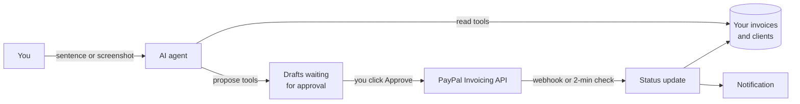

# PayPilot

PayPilot is an AI assistant for the money side of freelance and small-business work, built on PayPal. You describe the job in a sentence and it drafts the PayPal invoice. When a client is late it writes the reminder. When you're about to spend money it tells you how likely you are to be able to afford it, based on how your clients actually pay. Nothing reaches PayPal or a client until you approve it.

Built for the *Build What's Next with PayPal and AI* hackathon (2026).


- **Watch the demo (2:40):** [youtube.com/watch?v=Bzp4Qd1dVu0](https://www.youtube.com/watch?v=Bzp4Qd1dVu0)
- **Try it:** https://paypilot-app.azurewebsites.net. Every visitor gets a private copy. Click *Try the demo* for sample data, or connect your own PayPal sandbox.
- **Run it yourself:** [three commands](#run-it-on-your-computer).
- **How it's built:** [docs/ARCHITECTURE.md](docs/ARCHITECTURE.md). A file-by-file tour is in [docs/CODE-WALKTHROUGH.md](docs/CODE-WALKTHROUGH.md).

---

## The problem

Getting paid on time is one of the most common problems a small business has.

- 56% of US small businesses are owed money on unpaid invoices, $17,500 on average, and 47% have invoices more than 30 days overdue ([QuickBooks, 2025](https://quickbooks.intuit.com/r/small-business-data/small-business-late-payments-report-2025/)).
- In the UK, businesses hit by late payment spend about 86 hours a year chasing it ([Small Business Commissioner](https://www.smallbusinesscommissioner.gov.uk/new-powers-for-the-small-business-commissioner-as-part-of-government-package-to-tackle-late-payments/)).
- The US has about 72.9 million independent workers ([MBO Partners, 2025](https://www.mbopartners.com/state-of-independence)).

In practice it comes down to three things. Invoicing gets put off. Chasing a client feels awkward, so it doesn't happen. And nobody can say with confidence "can I afford this next month?", because that depends on when clients pay.

## What it does

### Bill
- **Invoice from a sentence or a screenshot.** For example, *"Bill Marcus Vance for 3 ad creatives at $145 and a $60 rush fee, due in 10 days."* The AI fills in an invoice you can edit, then you approve it and it goes out through PayPal's Invoicing API.
- **Pay to unlock.** Attach the final files to an invoice. The client's link stays locked until PayPal reports the invoice paid, then opens by itself.
- **Early-pay discount and deposits.** Offer 2% off for paying within 48 hours (removed on PayPal if the window passes), or ask late payers for a 50% deposit.
- **Retainers.** Bill a client the same amount every week or month. Each one is drafted for your approval.

### Get paid
- **Autopilot reminders.** Every unpaid invoice gets a plan: a friendly note before the due date, a firm one after, a final one with an optional late fee. The tone follows how late it is, and the voice follows the client. A good client gets a light check-in; a repeat late payer gets the terms and dates.
- **Live payment status.** PayPal webhooks and a check every 2 minutes mark invoices paid and notify you right away.
- **Receipts.** Every paid invoice gets a numbered receipt. PayPilot shows which ones still need sending, for example when a company paid by bank transfer.
- **Your client's view.** See exactly what the client receives: the email, the payment page, the receipt and the files.

### Plan
- **Budget Estimator.** *"Can I buy a $2,000 laptop on Dec 5?"* It simulates 4,000 possible futures of who pays you and when, after PayPal fees, tax and bills. It answers with the chance, the most you can safely spend, and which invoice decides it.
- **Suggested retainers.** It finds clients who already buy almost every month and prices a monthly plan for them.
- **Growth.** It groups clients into segments (loyal, slipping away, valuable but slow), ranks industries and kinds of work, and measures income concentration and days sales outstanding. The AI writes a 90-day plan from those figures.
- **Tax summary.** Income, fees, estimated-tax quarters and which 1099 forms to expect, using the 2026 IRS rules.

### Freelancers and businesses
At setup you choose freelancer or business. Both get every feature under the same names. Freelancers see "who owes me" first; businesses see receivables aging and growth first. A freelancer picks a profession. A business describes what it sells in one sentence, and the AI turns that into its own kinds of work, invoice shortcuts and wording.

| Budget | Invoices | Growth |
|---|---|---|
|  |  |  |

| Assistant | Receipts | Your client's view |
|---|---|---|
|  |  |  |

---

## How it works



The design rests on one rule: **the AI proposes, a person approves.** The model has two kinds of tools. Read tools return facts computed in code, such as invoices, client habits, forecasts and budget results. Propose tools put a draft in a queue. Only a click on Approve calls PayPal. So even a prompt injection hidden in a screenshot can at worst create a wrong draft, which you can see and discard.

Other things worth knowing:
- **Numbers come from code, words from the AI.** Risk, forecasts, the budget and growth figures are all computed; the AI only explains them. Every AI feature has a plain fallback, so the app also works without an AI key.
- **No double sends.** An approval is claimed atomically, and every PayPal write carries a `PayPal-Request-Id`. A double click, two tabs or a network retry can't create a second invoice.
- **The demo keeps visitors apart.** On the hosted demo, every visitor gets a private workspace with its own database. Visitors can connect their own PayPal sandbox, and nobody else can see it.

**Stack:** Node.js 22, Express 5, SQLite (Node's built-in `node:sqlite`), Google Gemini through `@google/genai` (Claude or any OpenAI-compatible API also work), PayPal REST APIs, and plain HTML/CSS/JavaScript with no build step.

### PayPal APIs used

| API | Used for |
|---|---|
| `POST /v1/oauth2/token` | Access token (cached per set of keys) |
| `POST /v2/invoicing/generate-next-invoice-number` | Invoice numbers |
| `POST /v2/invoicing/invoices` | Create invoices with tax, deposits and discounts |
| `POST /v2/invoicing/invoices/{id}/send` | Send the invoice to the client |
| `GET /v2/invoicing/invoices/{id}` | Check status and payments |
| `POST /v2/invoicing/invoices/{id}/remind` | Send a reminder |
| `POST /v2/invoicing/invoices/{id}/cancel` | Cancel |
| `PUT /v2/invoicing/invoices/{id}` | Add a late fee, remove an expired discount |
| `POST /v2/invoicing/invoices/{id}/payments` | Record a bank or cash payment |
| `POST /v1/notifications/verify-webhook-signature` | Verify webhooks before trusting them |

---

## Run it on your computer

You need [Node.js](https://nodejs.org) version 22.13 or newer. Check with `node --version`.

```bash
git clone https://github.com/Arpit052/paypilot.git
cd paypilot
npm ci
npm start
```

Then open http://localhost:3000. On Windows you can also double-click `start-windows.bat`, which installs what's needed and opens the app.

On the welcome screen, choose one of these:
- **Try the demo.** This needs no keys. PayPal is simulated and several months of sample invoices are loaded.
- **Connect PayPal sandbox.** Paste your sandbox keys (see below). PayPilot checks them with PayPal before saving them.

### Get PayPal sandbox keys (5 minutes)
1. Sign in at [developer.paypal.com](https://developer.paypal.com). Any PayPal account works.
2. Open **Apps & Credentials**, make sure **Sandbox** is selected, and click **Create App** (type: Merchant).
3. Copy the **Client ID** and **Secret** into PayPilot's welcome screen or **Settings → PayPal**.
4. Under **Testing tools → Sandbox accounts**, PayPal has created two test accounts: a *Business* one (you, sending invoices) and a *Personal* one. Use the Personal one's email as a client, then log in to [sandbox.paypal.com](https://www.sandbox.paypal.com) with it to pay the invoice.

### Add an AI key (optional, free)
Get a free key at [Google AI Studio](https://aistudio.google.com/apikey), then create a file called `.env` in the project folder:

```
GEMINI_API_KEY=your-key-here
```

Restart the app. Without a key everything still works, except the Assistant chat; reminders then use built-in templates. On Windows, `check-ai.bat` tests your key and picks a working model.

### Check your sandbox setup
```bash
npm run sandbox-check
```
This makes a few real sandbox calls. It checks your keys and the Invoicing permission, creates a draft invoice and confirms the total to the cent, confirms that a repeated request doesn't create a second invoice, and checks that a forged webhook is rejected. It then deletes the draft. Nothing is sent to anyone.

---

## A two-minute tour

1. Open the **Assistant** and type: *"Bill Marcus Vance for 3 logo concepts at $150 each, due in 10 days."* A draft appears with a warning, because Marcus usually pays late. Click **Approve & send**.
2. Open **Invoices → Needs you**. The AI has written reminders for late invoices, with the pay link inside. Approve one.
3. Open **Budget**, enter $1,800 and a date three weeks away. Read the verdict and which invoice it depends on.
4. Open any invoice and click **Your client's view**. Walk through what the client sees, then pay with the practice checkout. The invoice turns paid and a receipt appears.
5. Open **Growth** to see which clients to look after and the 90-day plan.

---

## Deploy

It runs on [Render](https://render.com) (a blueprint is included) or [Azure App Service](https://azure.microsoft.com/products/app-service) (built-in Node on Linux). [docs/DEPLOY.md](docs/DEPLOY.md) has the step-by-step for both.

The blueprint turns on visitor workspaces (`VISITOR_WORKSPACES=1`):
- Each visitor starts on the setup screen in their own private copy, picks *Try the demo* (one click, sample data) or connects their own sandbox, and never sees anyone else's data.
- Visitors can connect their own PayPal sandbox in Settings.
- The server holds no PayPal keys of its own.

There is also a `Dockerfile`:

```bash
docker build -t paypilot .
docker run -p 3000:3000 -v paypilot-data:/data --env-file .env paypilot
```

## Settings you can put in `.env`

All of these are optional. [.env.example](.env.example) lists them with comments.

| Variable | Default | What it does |
|---|---|---|
| `GEMINI_API_KEY` | – | Turns on the AI (or use `ANTHROPIC_API_KEY` / `OPENAI_API_KEY`) |
| `PAYPAL_CLIENT_ID`, `PAYPAL_CLIENT_SECRET` | – | Sandbox keys, if you'd rather not paste them in the app |
| `PAYPAL_WEBHOOK_ID` | – | Instant payment updates (otherwise PayPilot checks every 2 minutes) |
| `APP_PASSWORD` | – | Ask for a passcode before the app opens |
| `APP_TIMEZONE` | your computer's | Time zone for due dates, e.g. `America/New_York` |
| `VISITOR_WORKSPACES` | off | Give every visitor a private copy (for a public demo) |
| `DEMO_TIME_OFFSET_DAYS` | `0` | Move the app's clock forward so new invoices become overdue in a demo |

## Tests

```bash
npm test
```

The suite contains 128 end-to-end tests. They run PayPal as a local twin and use a scripted AI, so they need no keys. They cover approvals and duplicate protection, webhooks arriving twice or out of order, PayPal errors and timeouts, exact cents, the budget model's properties, aging/DSO/concentration against hand-worked numbers, CSV injection, pay-to-unlock, and visitor isolation. GitHub Actions runs them on every push. [docs/TESTING.md](docs/TESTING.md) describes what was tested and what was fixed.

## Security and privacy

- **No secrets in the repo.** Keys live in `.env` or in the app's local database, both of which are git-ignored. They are never sent to the browser.
- **Sandbox only.** The hosted demo runs in demo mode or on a visitor's own sandbox keys.
- **Verified webhooks.** Webhook signatures are checked with PayPal before anything changes.
- **App protection.** There is an optional passcode (scrypt-hashed, 10 attempts a minute), a same-origin check on every write, a strict Content-Security-Policy, and CSV exports protected against formula injection.

## Project layout

```
server.js            HTTP routes and middleware
src/                 Everything behind the API (one file per feature, see the walkthrough)
public/              The web pages: plain HTML, CSS and JavaScript
test/                End-to-end tests (node --test)
scripts/             seed, sandbox-check, AI check, passcode reset
docs/                Architecture, code walkthrough, testing, deploy guide, screenshots
render.yaml          Render blueprint for the public demo
Dockerfile           Container image
```

## License

[MIT](LICENSE)
