# PayPilot: an AI money agent for freelancers and small businesses, built on PayPal

**Web developers, designers, writers, marketers, video editors, consultants, photographers, virtual assistants and every other independent professional have the same problem: the work is done, but the money isn't in. PayPilot turns a plain-English description (or a screenshot) into a PayPal invoice, chases late payers with reminders whose tone escalates, tells you whether you can afford a purchase from how each client really pays, tracks every receipt you owe, and learns from your history which clients, industries and kinds of work to grow.** Nothing goes out without your approval.

Built for the *Build What's Next with PayPal and AI* hackathon.

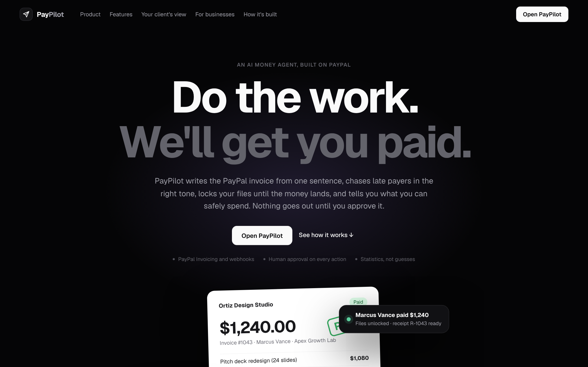

Open the app and you land on a page that explains what PayPilot does, section by section as you scroll; **Log in** or **Get started** takes you into the setup portal.


---

## The problem

Getting paid is a small-business problem, not just a freelancer one:

- **56%** of US small businesses have unpaid invoices, owed **$17,500** on average, and **47%** have invoices more than 30 days overdue (Intuit QuickBooks Small Business Late Payments Report, 2025).
- In the UK, businesses hit by late payment spend about **86 staff hours a year** chasing it, and late payment is linked to about **14,000 business closures a year** (UK Office of the Small Business Commissioner research, July 2025).
- The US alone has about **72.9 million** independent workers (MBO Partners, State of Independence 2025), on top of millions of small service businesses.

Behind those numbers are three everyday pains: invoicing gets put off, chasing is awkward so it doesn't happen, and nobody can say with confidence *"can I afford this next month?"* because it depends on when clients pay.

## Who it's for

PayPilot doesn't care what work you do, only how you get paid. On the first screen you pick what you do: **Web Developer, Graphic Designer, Content Writer, Digital Marketer, Video Editor, Consultant, Photographer, Virtual Assistant**, or **Other** (type your own, e.g. "Interior designer"). That sets sensible payment terms, reminder style, the invoice note, one-click line items, and the words the AI uses (*maintenance retainer*, *content retainer*, *monthly editing package*). The demo loads the same six realistic clients for every profession (Kiran Deshmukh at Overcast Labs, Rachel Adams at Summit Peak Consulting, Marcus Vance at Apex Growth Lab, William Evans at Voltline Energy, Sofia Martinez at Lumen Health, Daniel Brooks), each buying that profession's kind of work with their own payment habits.

## What PayPilot does

**Bill**

| Feature | How it works |
|---|---|
| **Text → invoice** | *"Bill Marcus Vance (marcus@apexgrowthlab.io) for 3 ad creatives at $145 plus a $60 rush fee, due in 10 days."* The AI extracts client, line items, rates and due date and puts an editable **invoice slip** in the approval tray. |
| **Screenshot → invoice** | Paste a screenshot of a client's email or chat; a vision model reads it and drafts the invoice. |
| **Human-in-the-loop** | The AI can only *propose*. Nothing reaches PayPal or a client until you click **Approve & send via PayPal**, and you can edit any field first. |
| **Real PayPal invoices** | Approved drafts are created and sent with the **PayPal Invoicing v2 API**, with clean numbers (#1042), per-line sales tax, reference/PO and notes. The client gets PayPal's email and payment page. |
| **Pay to unlock** | Attach the final work (a Figma, Drive or Dropbox link) to an invoice. The client gets a private page that stays **locked until the invoice is paid**; the moment PayPal reports the payment (webhook or the 2-minute check), the page unlocks by itself and you're notified. The real link is never shown before payment. |
| **Early-pay discount** | "Pay within 48 hours and get 2% off." The invoice goes out with a PayPal invoice-level discount; if it isn't paid in time, PayPilot removes the discount on PayPal (full update) and the normal due date applies. The suggested percentage comes from the client's history: 3% for late payers, 2% for new or slightly late clients, **none** for clients who already pay on time. |
| **Deposits for risky clients** | If a client usually pays late, a **50% deposit** is added with PayPal's partial-payment option. Where PayPal doesn't offer split payments (e.g. India), the invoice still goes out and the deposit is requested in the note. |
| **New invoice form** | Bill without the chat, with a live paper-invoice preview. Defaults (currency, terms, tax, note) come from Settings. |
| **Retainers** | Bill a client the same amount every week or month. Each date drafts the invoice for your approval; cards show next date, billed so far and yearly value. |

**Get paid**

| Feature | How it works |
|---|---|
| **Autopilot** | Every unpaid invoice gets a follow-up plan: friendly heads-up before the due date, firm reminder after, final reminder (+ optional late fee) later. On each date the AI writes the email in your style and asks for approval. Tone never softens after a firmer reminder. Off = nothing is drafted unless you ask. |
| **Reminders that know the client** | The tone follows lateness; the *voice* follows the relationship. A good client gets a warm check-in ("Hope all is well! Just floating invoice #1044…"); a repeat late payer gets a formal note with the days overdue, your payment terms (Net 15), a pay-by date and the date the late fee applies. |
| **Paid on / expected on** | Every invoice shows when the money came in (and how early or late), or for unpaid ones **when it's likely to arrive** with a range ("≈ Nov 14, Nov 12 – 18"), from that client's own payment history. |
| **Invoices** | One place for every invoice, in four tabs: **Needs you** (reminders due or written, drafts to approve), **Awaiting payment** (with the expected date and the next planned reminder), **Upcoming** (retainers and recurring invoices) and **Paid** (paid date, early or late, receipt status). A reminder you just sent pauses the next one for a few days, and every reminder carries the pay link inside the message. A "Coming up" rail shows what Autopilot will do. |
| **Late fees** | Suggested on very late invoices and added to the PayPal invoice (full update) only after you approve. |
| **Live payment status** | PayPal webhooks (signature-verified) plus an automatic check every 2 minutes flip invoices to **Paid** and push a notification to every open tab over Server-Sent Events. Invoices you create on paypal.com are imported automatically. |
| **Mark as paid** | Paid by bank transfer or cash? Record it (two clicks to confirm) and PayPilot records the payment on the PayPal invoice too. |
| **Copy pay link** | Copy PayPal's payment link to send by text or WhatsApp. |

**Earn more, spend safely**

| Feature | How it works |
|---|---|
| **Budget Estimator** | *"Can I buy a $2,000 laptop on Dec 5?"* PayPilot plays out 4,000 possible futures of who pays you and when, using each client's own payment history. It counts what really happens to freelance money: **PayPal's fee** (3.49% + $0.49) and the **share you keep for tax** come off every payment, **bills leave on their day** (rent on the 1st), and the purchase only counts as safe if your balance **stays above your cushion for the 30 days after**, so next month's rent is covered too. It answers with the **chance** (and its error margin), **the most you can safely spend** on that date, the **lowest your balance gets**, the **earliest safe date**, what happens **if you wait** a week or a month, and **which invoice decides it**. You can **pay in instalments**, and **untick an invoice** to see what happens if that client never pays. The verdict card says it plainly ("Risky on Dec 1 · Safe from Dec 12") and tells the story behind it, with a **day-by-day typical path**: every expected payment and bill, and your balance after each. Before you estimate anything, the page shows the money on its way. Also in the Assistant. [How the model works](#how-the-budget-estimator-works) |
| **Suggested retainers** | Finds clients who already buy from you nearly every month, prices a monthly plan a little below a typical month with them, and shows both sides of the deal: what you gain a year, what they save, fewer invoices, and how fast your existing retainer clients pay compared with them. The AI writes the offer email in your style; when they say yes, one click creates the retainer. |

**Freelancer or business**

| Feature | How it works |
|---|---|
| **Two ways to use it** | Setup asks whether you're a **freelancer** or a **registered business**. Both get every feature, under the same names. Freelancers get **getting paid** first: the dashboard opens on who owes you, which reminder is due, and a "bill a client in one sentence" box. Businesses get **analysis** first: money owed by age (receivables aging), days sales outstanding, repeat customers and the top three places to grow, with Growth and Analytics higher in the menu and Net 30 terms by default. Switch anytime in Settings; the data is the same. |
| **A clean start** | A real (PayPal-connected) account starts empty. Tick "Add a few sample invoices" to try things; every sample row is tracked, and **Settings → Data → Remove sample data** deletes exactly those, keeping anything you created. Demo mode loads the full sample book. |

**Track, as a business**

| Feature | How it works |
|---|---|
| **Receipts** | Every paid invoice gets a numbered receipt (R-1042). PayPal emails its own when a client pays through PayPal; bank transfers and cash recorded with *Mark paid* get none, and a company's accounts team usually needs one. The Receipts page shows which receipts still **need sending**, emails them in one click, and shows when the client **opened** the receipt (the owner's own preview isn't counted). Each receipt has a private, printable page. |
| **Your client's view** | From any invoice: see exactly what the client gets, step by step. The invoice email from PayPal, the payment page, the receipt (watermarked as a preview until paid) and, if files are attached, the locked or unlocked files page. **View and pay** and **Pay** open the real payment page: PayPal's own page on a sandbox account, or a practice checkout (card or PayPal account, test details filled in, receipt at the end) in demo mode. Also offered right after you send a new invoice. |
| **Growth** | PayPilot learns from a year of invoices and tells you where to focus. **Client segments** (Champions, Loyal, Valuable but slow, Slipping away, New, One-off) from each client's own buying rhythm; a **client map** of value against lateness; **industries** ranked by value per client and on-time payment, with a 3-month trend (each client's industry is worked out from the company name, email domain and work billed, with AI for anything unclear, and marked "auto" until you set it); **work areas** grouped for your profession (a web developer's *Integrations and APIs*, a designer's *Print and packaging*) with what's rising and what stopped; **income concentration** (Herfindahl index) and **days sales outstanding** now vs 90 days ago. **Opportunities** are ranked by the money at stake (a big new client or a client who is half your income comes first), with the top three shown, each with its basis and an amount only when the amount follows from your book. Clients who **pay up front** are recognised and never treated as slow. Line items the rules can't place are grouped by AI into new work areas. For businesses: **receivables aging** and **new customers by month and how many came back**. A **90-day plan** is written by the AI from those figures, or from rules when there is no AI, and rewritten whenever your invoices change. Set each client's industry right on the page. Also in the Assistant ("Where should I focus?"). [How it works](docs/ARCHITECTURE.md#growth-srcgrowthjs) |

**Understand**

| Feature | How it works |
|---|---|
| **Dashboard** | Earned this month, waiting, overdue, and the 30-day forecast with an **info popover that shows the exact sum** (each invoice × the chance it's paid in 30 days). Money brief, monthly chart, top customers, searchable invoice table with CSV export. |
| **Tax summary** | One click from Analytics: gross income, sales tax collected, PayPal fees (deductible), net income, income by IRS estimated-tax quarter with due dates, a rough self-employment tax figure, and which 1099 forms to expect (1099-K from PayPal past $20,000 and 200 payments; 1099-NEC from clients who paid $2,000+ outside PayPal from 2026). Print to PDF or download CSV for your accountant. |
| **Analytics** | Revenue trend with hover, KPIs vs the previous period (revenue, days to get paid, on-time rate, average invoice), when clients pay, unpaid by age, per-client behaviour with trends, best-earning work, and plain-English insights. |
| **Calendar** | Due dates, payments received, reminders sent and Autopilot's planned reminders on a month grid, with actions per day. |
| **Money brief** | A step-by-step report with AI recommendations; numbers are computed in code, the AI only writes the headline and actions. |
| **Client risk** | No risk / Low / Medium / High / New, from real payment history. The agent warns you before invoicing a risky client. |
| **Ask anything** | *"Who owes me money?"*, *"Who is my best customer?"*, *"Cancel Rachel's invoice."* Answers come from your data via tools, never from guesses. |

**Run it**

| Feature | How it works |
|---|---|
| **Search (Ctrl/⌘ K)** | Find any invoice, client, page or action, or send the query straight to the Assistant. |
| **Professions** | Web Developer, Graphic Designer, Content Writer, Digital Marketer, Video Editor, Consultant, Photographer, Virtual Assistant or Other (your own words): presets for terms, reminder style, invoice note and line-item shortcuts, plus matching sample work in the demo. |
| **Settings** | Business, invoice defaults, PayPal connection, Autopilot plan, late fees, notification types, AI writing style (warm / neutral / brief) with a live preview, data export/backup, security. |
| **Connect in the app** | First run asks for a business name and PayPal sandbox keys (checked with PayPal before saving), or opens demo mode. |
| **Passcode + sign out** | Lock PayPilot with a passcode (scrypt-hashed) and sign out from the sidebar. |

| Budget Estimator | Suggested retainers | Tax summary |
|---|---|---|
| 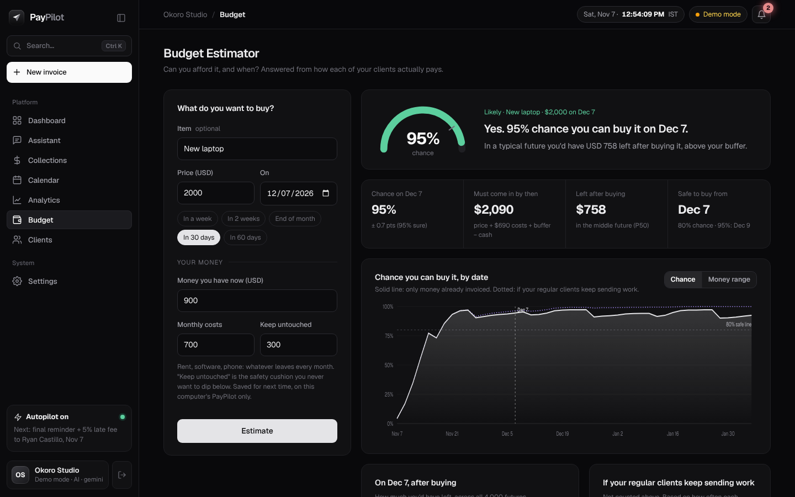 | 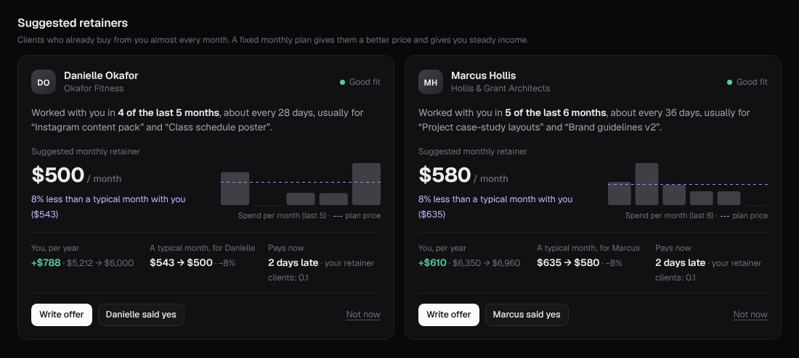 | 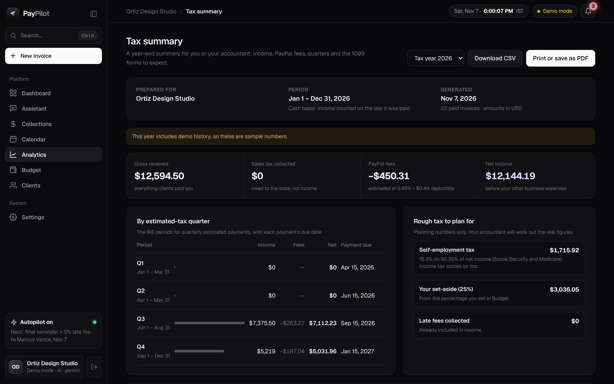 |

| Invoices + Autopilot | Analytics | Calendar |
|---|---|---|
| 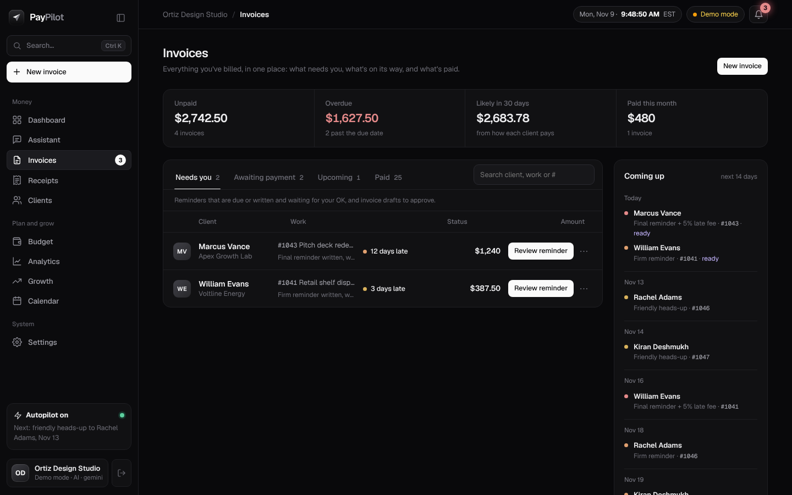 | 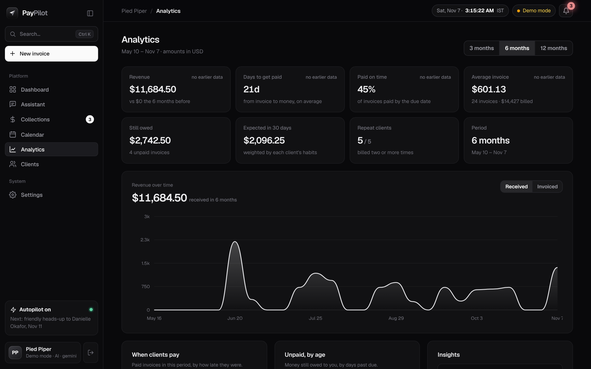 | 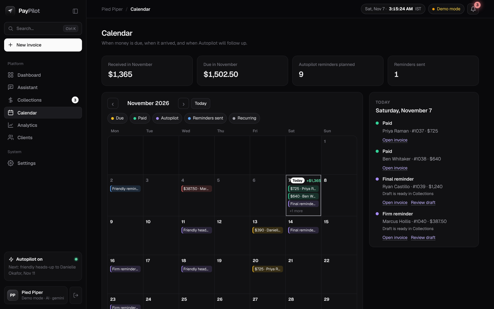 |

| Dashboard | Clients + retainers | Settings |
|---|---|---|
|  |  | 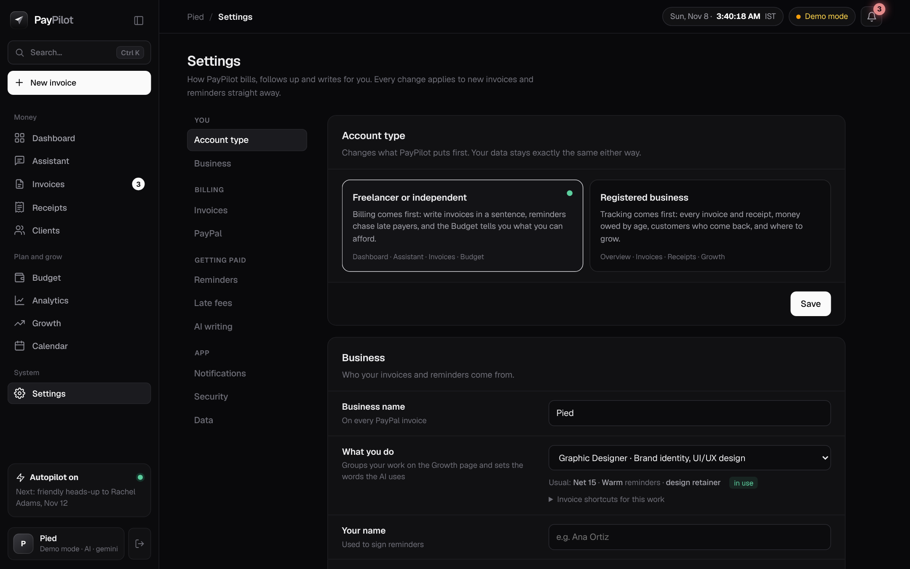 |

| Growth | Receipts | Your client's view |
|---|---|---|
| 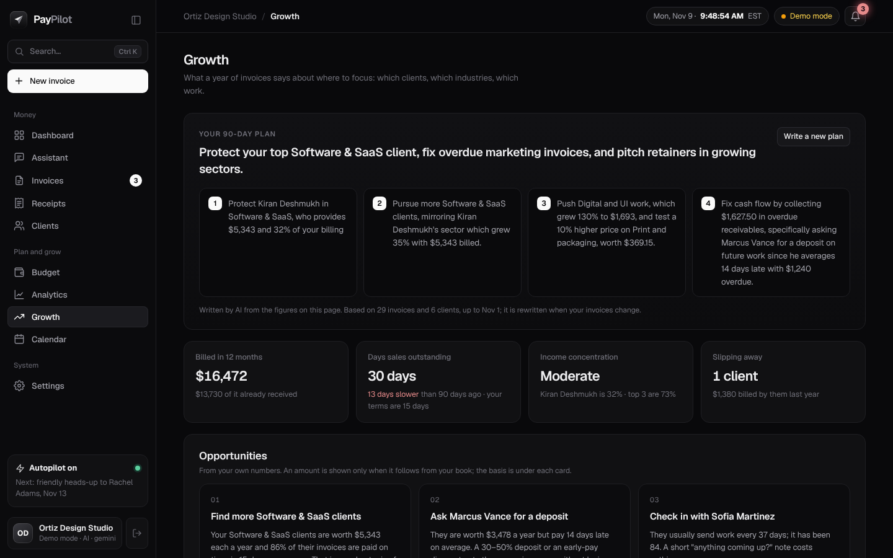 | 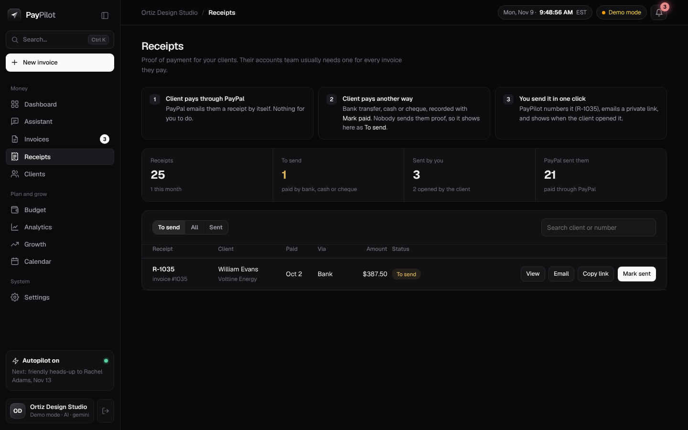 | 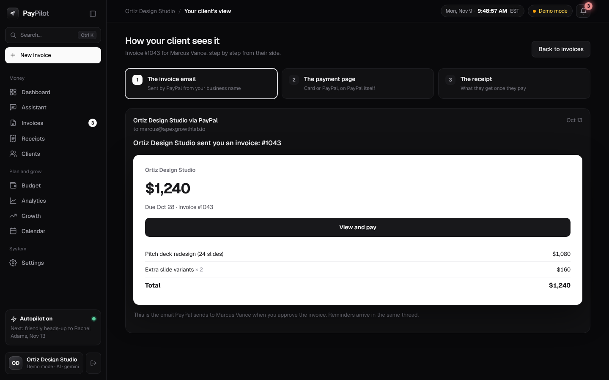 |

---

## Architecture

A longer walkthrough of the design (approval queue, payment model, growth analysis, public token pages, security) is in **[docs/ARCHITECTURE.md](docs/ARCHITECTURE.md)**.

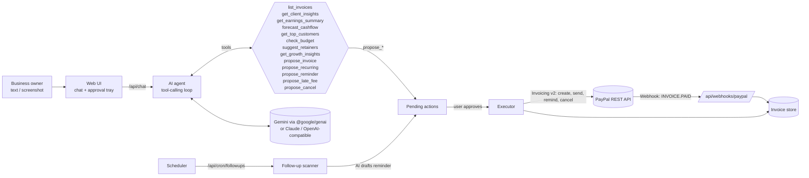

**Design.** A calm black interface with a left sidebar, invoices rendered as white paper slips, and charts drawn in plain SVG. The PayPilot logo and wordmark are original; fonts (Geist, Unbounded, Manrope; SIL Open Font License) are bundled so it looks right offline.

**Stack.** Node.js + **Express 5** API, **SQLite** (Node's built-in `node:sqlite`, with a transactional repository layer and automatic migrations), **Google Gen AI SDK** (`@google/genai`) for Gemini, PayPal REST APIs, and a vanilla-JS frontend.

**Reliability and security.**
- **Exactly-once payments:** approvals are claimed atomically (a double-click can't send twice), and every PayPal write carries a `PayPal-Request-Id` and a local checkpoint, so a retry after a network failure resumes instead of creating a duplicate invoice.
- **Resilient AI:** if the primary Gemini model is rate-limited or overloaded, PayPilot falls back to other Gemini models (each has its own quota) and handles thought signatures across models.
- **Background jobs:** a scheduler (default every 6 h) syncs payment status from PayPal, creates due recurring drafts, and drafts reminders for overdue invoices. Everything still waits for approval.
- **Optional passcode login** (`APP_PASSWORD`) with an HMAC-signed, HttpOnly session cookie. Webhooks, cron and `/api/health` stay public.
- **Traceable requests:** every response carries an `X-Request-Id` (yours is echoed back if you send one), and errors and slow API calls are logged with it.
- **CI and containers:** GitHub Actions runs the full suite on Node 22 and 24 with no secrets; a `Dockerfile` builds a small non-root image with a health check.
- Per-IP rate limiting on AI endpoints, a strict Content-Security-Policy and other security headers, verified PayPal webhooks, and dates computed in the business time zone (`APP_TIMEZONE`).

**Agent design.** The model gets **read tools** (invoices, client insights, earnings, forecast) and **proposal tools**. Proposal tools validate the draft (email format, positive amounts, due date not in the past) and create a *pending action*. They never call PayPal. Only the `/api/actions/:id/approve` endpoint, triggered by a human click, runs the PayPal calls. So even if the model gets confused or receives a prompt injection through a screenshot, it can't move money or message a client.

### PayPal APIs used

| API | Endpoint | Used for |
|---|---|---|
| OAuth 2.0 | `POST /v1/oauth2/token` | Client-credentials token (cached) |
| Invoicing v2 | `POST /v2/invoicing/generate-next-invoice-number` | Invoice numbering |
| Invoicing v2 | `POST /v2/invoicing/invoices` | Create draft invoice, with per-line **sales tax**, **partial payment** (deposit) and an invoice-level **early-pay discount** |
| Invoicing v2 | `POST /v2/invoicing/invoices/{id}/send` | Send to client (PayPal email and payment page) |
| Invoicing v2 | `GET /v2/invoicing/invoices/{id}` | Poll status and payments |
| Invoicing v2 | `POST /v2/invoicing/invoices/{id}/remind` | AI-drafted payment reminders |
| Invoicing v2 | `POST /v2/invoicing/invoices/{id}/cancel` | Cancel an invoice |
| Invoicing v2 | `PUT /v2/invoicing/invoices/{id}` | Full update: add a late fee, remove an expired early-pay discount |
| Invoicing v2 | `POST /v2/invoicing/invoices/{id}/payments` | Record a payment made outside PayPal (mark as paid) |
| Webhooks | `POST /v1/notifications/verify-webhook-signature` | Verify `INVOICING.INVOICE.*` events |

### AI tools used

- **LLM with tool calling.** Three adapters behind one interface: **Google Gemini** (official `@google/genai` SDK, with thought-signature round-tripping), **Claude** (Anthropic Messages API), and any **OpenAI-compatible** API (OpenAI, Groq, OpenRouter, local models).
  - **Agent loop** (`src/llm.js`, `src/agent.js`): multi-step tool calling over PayPal data, intent and entity extraction from free text, and multilingual replies.
  - **Vision** (`src/agent.js`): reads client emails and chat screenshots to draft invoices.
  - **Generation** (`src/followups.js`): writes reminder emails using the client's payment history and the escalation tone.
- **Deterministic analytics** (`src/analytics.js`): risk scoring and the probability-weighted forecast, so the numbers the AI reports come from data, not guesses.
- **Statistics** (`src/budget.js`, `src/offers.js`, `src/growth.js`): a Monte Carlo cash model, a buying-pattern score, and growth analysis (segments, sector and work-area trends, concentration, DSO). The AI calls them as tools (`check_budget`, `suggest_retainers`, `get_growth_insights`) and explains the result; it never makes the numbers up.
- **Planning** (`src/growth.js`, `src/brief.js`): the AI writes the Money brief and the 90-day Growth plan from a JSON of computed facts, with deterministic fallbacks.

### How the Budget Estimator works

The money you'll have on a date is uncertain because you don't know when, or if, each client pays. So PayPilot simulates it:

1. **Each client's payment habit.** Every paid invoice tells us how many days after the due date the money arrived. A client with few payments is blended with everyone's history (empirical Bayes: their own data gets weight *n / (n + 3)*), and each draw gets ~1.5 days of noise (kernel smoothing) so the model doesn't only repeat the past.
2. **Conditioning on today.** An unpaid invoice hasn't been paid yet, so only futures where it arrives today or later are kept. If a client is later than ever before, the extra wait follows an exponential tail fitted to their late payments.
3. **Money that never comes.** Each invoice is paid at all with probability from a Beta(49, 1) prior (98%) updated with the client's paid invoices; once it's later than the client's slowest payment ever, that chance halves every 60 days.
4. **Retainers and new work.** Scheduled retainer invoices are included. Optionally, repeat clients send new work as a Poisson process with their own rate and amounts.
5. **Money that actually reaches you.** Every payment is reduced by PayPal's invoicing fee and your tax set-aside. Bills come off on their day of the month (a monthly-minimum sliding window makes the 30-day check fast); everyday spending is spread per day.
6. **4,000 futures.** A future is a "yes" if, after paying (each instalment, if you split it), your balance never drops below your cushion for 30 days. The answer is the share of "yes" futures (± the 95% Monte Carlo error), the P10 / P50 / P90 of your lowest balance, the most you can spend and still be 80% or 95% safe (the 20th / 5th percentile of spare money), the first date the chance reaches 80% and 95%, and each invoice's *swing*: P(yes | it arrives in time) − P(yes | it doesn't).

Results are seeded, so the same inputs always give the same answer, and the page explains the method in plain English.

### How retainer suggestions work

For each client over the last 180 days PayPilot measures how many months they bought in (*coverage*), how regular the gaps are (1 − coefficient of variation), and how much they spend in an average month and in a typical month they do buy. Only clients who buy at least every ~40 days, in 75%+ of months, and aren't high-risk payers are suggested. The price is a typical month's spend minus 3–10% (smaller when they already buy every month), rounded the way people price things. The card shows the yearly change for you, the monthly saving for them, and how quickly your current retainer clients pay compared with this client.

---

## Run it locally (about 5 minutes)

**You need:** Node.js 22.13 or newer (uses Node's built-in SQLite).

```bash
git clone <this-repo> paypilot && cd paypilot
npm ci
npm start                   # → http://localhost:3000
```
Open the link. The welcome screen offers **Try the demo** (no keys, sample book loaded) or **Connect PayPal sandbox** (paste your Client ID and Secret; PayPilot checks them with PayPal before saving). You can also put keys in a `.env` file (`cp .env.example .env`).
On Windows you can just double-click **`start-windows.bat`**. To check your AI setup, double-click **`check-ai.bat`**. It tests your key against Gemini and writes a working model and setting into `.env`.

### 1. PayPal sandbox keys
1. Sign in at [developer.paypal.com](https://developer.paypal.com) and open **Apps & Credentials** with **Sandbox** selected.
2. Create an app (type *Merchant*) and paste the **Client ID** and **Secret** on the welcome screen or in **Settings → PayPal** (or put them in `.env`).
3. Under **Testing tools → Sandbox accounts** you'll find a *Business* account (that's you, the invoicer) and a *Personal* account (use it as the client and to pay invoices).

### 2. AI key
Set **one** of:
- `GEMINI_API_KEY`: free key from [Google AI Studio](https://aistudio.google.com) (uses Gemini's native API, model `gemini-3.6-flash` by default)
- `ANTHROPIC_API_KEY`: Claude
- `OPENAI_API_KEY`: OpenAI, or any OpenAI-compatible provider via `OPENAI_BASE_URL` and `OPENAI_MODEL`

### 3. (Optional) Sample history
Demo mode loads it for you. On a real account, tick *Add a few sample invoices* when connecting, or run:
```bash
npm run seed      # a year of sample clients and paid invoices, so risk, budget and growth have data
```
Sample rows are local only (never sent to PayPal) and **Settings → Data → Remove sample data** deletes exactly them.

### 4. (Optional) Webhooks for instant "Paid" updates
Expose your local server (e.g. `cloudflared tunnel --url http://localhost:3000` or `ngrok http 3000`). In your sandbox app, add a webhook to `https://<your-url>/api/webhooks/paypal` for **Invoicing** events, then put the **Webhook ID** in `PAYPAL_WEBHOOK_ID`. Without webhooks, PayPilot checks PayPal by itself every 2 minutes (`PAYPAL_SYNC_SECONDS`), and the refresh button on the dashboard checks right away.

### No keys? Try mock mode
With no PayPal keys (or `PAYPAL_MODE=mock`), PayPilot simulates PayPal in-process and adds a **Simulate payment** button. Use this to explore the UI offline. An AI key is still needed for the assistant. Without one, follow-ups use template reminders.

---

## Try this flow (what the demo video shows)

1. **Assistant:** *"Bill Marcus Vance (your-sandbox-personal-email) for 3 logo concepts at $150 each and an urgent revision for $60, due in 10 days."* An invoice slip appears with a risk warning, because Marcus pays late.
2. Edit a rate and click **Approve & send via PayPal**. The slip is stamped **SENT**. Open the sandbox personal account to see the invoice.
3. Pay it from the sandbox personal account. The dashboard flips to **Paid** through the webhook.
4. **Invoices → Needs you.** The AI drafts tone-matched reminders with the pay link inside. Approve one, and PayPal sends the reminder; the next one waits a few days.
5. **Budget:** ask *"Can I afford a $2,000 laptop next month?"* in the Assistant, or open **Budget** and try a price and date. Watch which invoice decides it.
6. **Clients → Suggested retainers:** open Rachel's card, write the offer, then click *Rachel said yes* to create the retainer. Run the budget again: it now counts her monthly payment.
7. **Receipts:** William Evans's company pays by bank transfer, so his newest payment still needs a receipt. Click **Email**, then open the receipt link as the client would.
8. **Any invoice → How your client sees it:** walk through the email, the payment page and the receipt from the client's side.
9. **Growth:** see that Software & SaaS is your best sector, that Sofia Martinez is slipping away, and the 90-day plan.

> **Tip for demos:** set `DEMO_TIME_OFFSET_DAYS=15` and restart to fast-forward the app's clock, so invoices you just sent become overdue and the follow-up flow runs against real sandbox invoices.

---

## Deploy (hosted demo)

**Docker:** `docker build -t paypilot . && docker run -p 3000:3000 -v paypilot-data:/data --env-file .env paypilot`

**Render:** New → Blueprint → select this repo (`render.yaml` is included). Add your keys in the dashboard. Scheduled follow-ups: create a Render Cron Job (or any cron service) that calls `GET https://<app>/api/cron/followups?key=<CRON_SECRET>` daily.

The blueprint sets up a **shared demo for judges**:
- `HOSTED_DEMO=1`: nobody can disconnect PayPal, reset or remove data, or change the passcode, so one visitor can't break it for the rest.
- `SEED_SAMPLE_ON_BOOT=1`: the free plan's disk is wiped on every restart, so the sample history is loaded again on boot.
- The free plan sleeps after 15 idle minutes and the first visit then takes about a minute. Open the link before you demo, ping `/api/health` with an uptime monitor, or use the Starter plan.
- If you set `APP_PASSWORD`, put it in the Devpost testing instructions.

Data is stored in SQLite at `data/paypilot.db`. Set `DATA_DIR` to a persistent disk for real use.

## Tests

```bash
npm test
```
These are end-to-end tests with mock PayPal and a scripted model. They cover the propose → approve → PayPal flow, user edits, validation, webhook payment, follow-up escalation and de-duplication, the dashboard maths, request mapping for the LLM providers, the PayPal invoice payload, and the Budget Estimator's statistics (ordered percentiles, repeatable results, more cash never lowers the chance, overdue invoices never "paid in the past"), retainer suggestions, tax / fees / bills / instalments / what-if in the budget, every profession's sample data, payment-date predictions and the forecast sum, reminder voice per client, the tax summary, pay-to-unlock (files hidden until paid) and early-pay discounts (applied, then removed after 48 hours), the landing page and routing, receipts (who needs one, sending, public links, previews not counted as views), the client's view, growth insights (segments, sectors, work areas per profession, honest opportunities, the AI plan and its fallback), client industries and request ids. The same suite runs in GitHub Actions on every push.

## Project layout

```
server.js            Express app + API routes
src/agent.js         System prompt, tool schemas + handlers, chat sessions
src/llm.js           Gemini (official @google/genai SDK), Anthropic + OpenAI-compatible adapters, tool-calling loop
src/paypal.js        PayPal Invoicing v2 client (sandbox/live) + mock
src/db.js            SQLite schema + repository (clients, invoices, actions, activity)
src/actions.js       Pending actions, approval, execution against PayPal
src/followups.js     Overdue scanner + AI reminder drafting
src/analytics.js     Risk score, earnings, cash-flow forecast
src/sync.js          Polling + webhook status updates
src/recurring.js     Recurring schedules → invoice drafts
src/scheduler.js     Background jobs (PayPal sync, overdue scan, recurring)
src/brief.js         Money brief: computed sections + AI recommendations
src/notify.js        Notifications: stored + pushed live over Server-Sent Events
src/budget.js        Budget Estimator: Monte Carlo cash model
src/offers.js        Retainer suggestions: buying-pattern scoring + AI offer emails
src/business.js      Professions and their presets
src/personas.js      Demo clients and the work each profession sells them
src/tax.js           Year-end tax summary (fees, quarters, 1099 hints) + CSV
src/delivery.js      Pay to unlock: private file pages that open once an invoice is paid
src/earlypay.js      Early-pay discounts: suggestion, window, automatic removal
src/receipts.js      Numbered receipts: who needs one, sending, public receipt pages
src/growth.js        Growth: segments, industries, work areas, concentration, DSO, opportunities, AI plan
public/landing.*     The public landing page
public/              UI (vanilla JS): dashboard, assistant, invoices, receipts, clients, analytics, growth, budget, calendar, settings, client view
docs/ARCHITECTURE.md How the parts fit, and why
.github/workflows/   CI: npm test on Node 22 and 24
Dockerfile           Production image (non-root, health check, /data volume)
test/                End-to-end tests
```

## Configuration (optional `.env` settings)
| Variable | Default | What it does |
|---|---|---|
| `APP_PASSWORD` | – | Require a passcode to open the app (recommended for a public demo URL) |
| `APP_TIMEZONE` | system time zone | Time zone for "today" and due dates, e.g. `America/New_York` |
| `DEFAULT_TAX_PERCENT` | `0` | Sales tax applied when none is specified |
| `GEMINI_FALLBACK_MODELS` | `gemini-3.5-flash,gemini-3.5-flash-lite,gemini-3.1-flash-lite` | Models to try when the main one is busy |
| `SCHEDULER_INTERVAL_MIN` | `360` | Background job interval in minutes (`0` = off) |
| `CHAT_RATE_LIMIT_PER_MIN` | `15` | Assistant messages per minute per IP |
| `PAYPAL_SYNC_SECONDS` | `120` | How often to check PayPal for new payments (real mode; webhooks are instant) |

## Security notes
- The AI cannot execute payments, reminders or cancellations. A human approves every action, including each recurring invoice.
- Webhook signatures are verified with PayPal before any state changes (sandbox/live).
- Keys live only in `.env` (git-ignored). Uploaded screenshots are sent to the model for that turn only and are not kept in chat history.

## Sources for the numbers above
- [Intuit QuickBooks, Small Business Late Payments Report 2025](https://agiled.app/statistics/late-payment-statistics) (summary)
- [UK Office of the Small Business Commissioner late-payments research, July 2025](https://stealthagents.com/research/small-business-overdue-invoice-statistics-2026) (summary)
- [MBO Partners State of Independence 2025](https://www.makerstations.io/?p=11005) (summary)

## License
[MIT](LICENSE)
